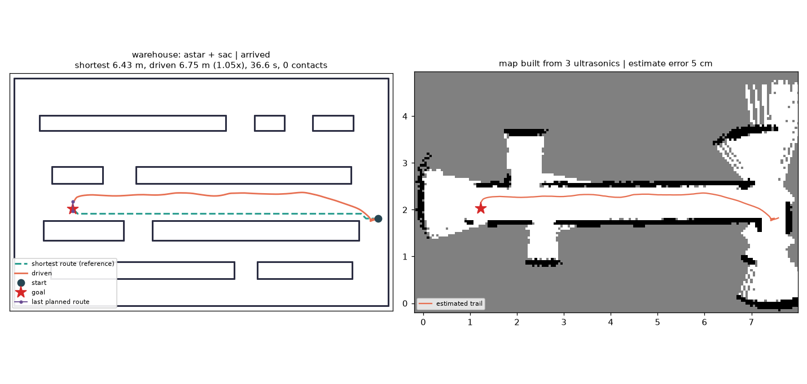
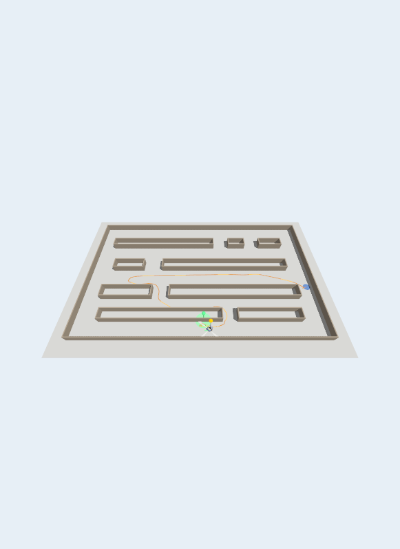
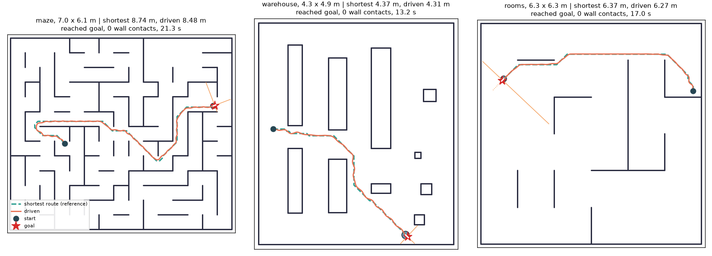
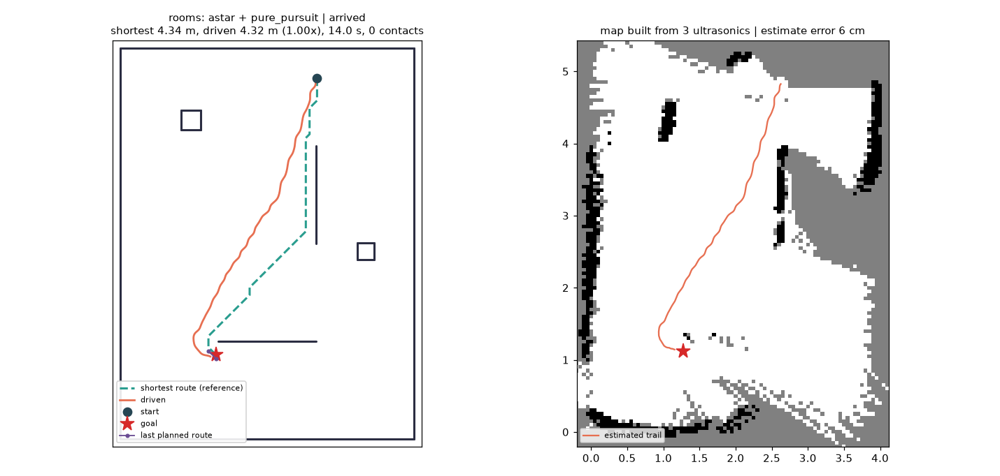
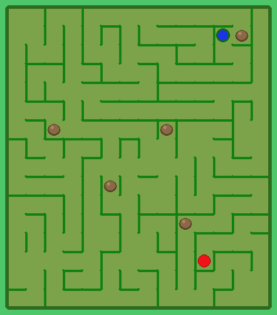

# Robocar RL: an RL rover that drives itself by motor PWM

ECE 244 autonomous rover project. A small two-wheeled rover drives to a goal
through an unknown maze or warehouse. It has no map at the start, and only
cheap sensors: three HC-SR04 ultrasonics, an HMC5883L compass and N20 wheel
encoders, plus an optional overhead webcam. A reinforcement-learning policy
decides the **left and right motor PWM duty 20 times a second**. The whole
system runs on ROS 2 (Lyrical).

> This repository is a showcase: results, pictures and design documents. The
> source code is private.



*Left: the true warehouse (hidden from the rover) with the shortest route and the
path driven. Right: the map the rover built from three ultrasonic beams while
driving. The driven route is 1.05 x the shortest, with 0 wall contacts and 5 cm
pose error.*

## Architecture

```
HC-SR04 x3, HMC5883L, wheel encoders, (overhead ArUco camera)
  -> EKF localiser (x, y, heading, odometry scale) + sonar occupancy map
  -> costmap (robot footprint, graded inflation, geofence)
  -> route planner: A* (default) | greedy best-first | RL route policy (DQN)
  -> RL motion policy (SAC): 17 observations -> left/right PWM at 20 Hz
  -> collision monitor -> /wheel_pwm -> ESP32 (micro-ROS, Wi-Fi) -> UART -> Pico -> TB6612FNG -> N20 motors
```

- **Two learned policies.** The L1 route policy is a value-iteration-style
  ConvGRU DQN (QR-DQN, noisy nets, PER, n-step). The L2 motion policy is SAC.
  It was trained half on route following and half on whole missions through
  the real navigator, on a rover simulator randomised around the real parts:
  - motors: dead band, lag, gain mismatch, battery sag
  - wheels: slip
  - HC-SR04: 15° cone, specular misses, dropouts
  - compass: bias and distortion
  - Wi-Fi command delay
- **Safety (Nav2-style).** Recoveries (clear map, spin, back off), stall
  detection from the encoders, a collision monitor, e-stop, manual/auto modes,
  and a 250 ms watchdog in the firmware.
- **Firmware** follows the team design. A Raspberry Pi Pico does all motor and
  sensor I/O. An ESP32 is the micro-ROS Wi-Fi bridge. They talk over a UART
  protocol with CRC-8 framing and a heartbeat.

Full design: [docs/ROVER_SYSTEM_DESIGN.md](docs/ROVER_SYSTEM_DESIGN.md)

## Results (unseen worlds, randomised rovers)

| Setting | Stack | Success | SPL | Route / shortest | Pose error | PWM decision |
|---|---|---|---|---|---|---|
| 4 m arena + overhead camera | A* + SAC | **93%** | **0.86** | 1.01 | 1 cm | 4 ms |
| 4 m arena, onboard sensors | A* + SAC | 90% | 0.82 | 1.04 | 6 cm | 3 ms |
| 4-8 m mazes/warehouses/rooms, onboard | A* + SAC | 75% | 0.62 | 1.10 | 10 cm | 3 ms |
| same, classical controller | A* + pure pursuit | 68% | 0.60 | 1.01 | 14 cm | 0.5 ms |

- The RL PWM policy beats a tuned pure-pursuit controller on every setting.
  It is also faster: 4.2-5.1 s per metre vs 5.2-5.7.
- The overhead camera cuts the pose error from 6 cm to 1 cm.

All tables: [docs/RESULTS.md](docs/RESULTS.md)

## Gap analysis

The system was compared against Nav2 and against Tai et al. (2017),
virtual-to-real RL navigation. It was also compared with Elfes (1987),
sonar occupancy grids, and evaluated with SPL (Anderson et al., 2018).
Ten gaps were closed, each with before/after measurements; changes that made
results worse were rejected and are listed too. Examples:

- collision monitor: +12 points success for the RL controller
- footprint-only lethal costmap: eliminated stuck missions
- overhead ArUco fix: 5.5 cm to 0.8 cm pose error
- training on whole missions: 65% to 77% success

Details: [docs/GAP_ANALYSIS.md](docs/GAP_ANALYSIS.md)

## More pictures

The simulation drawn in 3-D (Gazebo): walls to scale, the rover with its sonar beams,
the planned route (green), the driven trail (orange), start (blue) and goal (green).




| Simulator snapshot | Pure-pursuit baseline |
|---|---|
|  |  |

Earlier stage, a grid-maze DQN agent:



## Status

- Simulation and ROS 2 integration are complete and tested.
- The firmware is written but not yet built or flashed on the hardware.
- The next step is calibration on the assembled rover.
